<!-- Profile README · João Gabriel Alves Junior -->

  

   

  &nbsp;
  &nbsp;
  &nbsp;
  

 

## ⚡ What I Work On

My foundation is **backend engineering**: APIs, relational data models, distributed background jobs, and maintainable business systems. Having built software professionally since **2021** with **PHP, Laravel, WordPress/WooCommerce, and MySQL**, I increasingly architect systems with **Python, TypeScript, FastAPI, PostgreSQL (`pgvector`), and applied AI**.

I care about software that connects the whole problem — from domain modeling and ingestion pipelines to source-grounded LLM workflows and responsive user interfaces.

<table>
<tr>
<td width="50%" valign="top">

### 🛠️ Backend, Data & Integrations

Designing reliable APIs, relational schemas, background workers, and third-party integrations built for maintainability and operational clarity.

  
  
  
  
  
  
  
  
  
  

  
  
  
  
  
  

</td>
<td width="50%" valign="top">

### 🧠 Applied AI, Product & Infrastructure

Building source-backed RAG pipelines, LLM evaluation workflows, containerized services, and cross-platform web & mobile products.

  
  
  
  
  
  

  
  
  
  
  
  

</td>
</tr>
</table>

---

## 🚀 Selected Work

<table>
<tr>
<td width="50%" valign="top">

### 📡 [Observador de Concursos](https://github.com/Gabrieljr42/ObservadorConcursos)

A public-exam intelligence platform monitoring **99 configured Brazilian exam sources**, tracking document diffs/versions with background crawlers, and syncing structured notices to an **offline-first React Native + SQLite** mobile app.

  
  
  
  
  

[**Explore Repository →**](https://github.com/Gabrieljr42/ObservadorConcursos)

</td>
<td width="50%" valign="top">

### 🕯️ [ThePensive](https://github.com/Gabrieljr42/ThePensive)

An interactive research archive and 3D WebGL experience comparing **Retrieval-Augmented Generation (`pgvector`)** against **Full-Context** prompting with Gemini — complete with two-pass semantic citation verification, latency/cost telemetry, and exact passage provenance.

  
  
  
  
  

[**Explore Repository →**](https://github.com/Gabrieljr42/ThePensive)

</td>
</tr>
<tr>
<td width="50%" valign="top">

### 🏋️ [GymIA](https://github.com/Gabrieljr42/GYM-AI)

An AI-assisted workout planning platform for physical education professionals. Combines instructor/client management with a **fine-tuned OpenAI generation workflow** that produces structured, human-editable training plans persisted in MySQL.

  
  
  
  
  
  

[**Explore Repository →**](https://github.com/Gabrieljr42/GYM-AI)

</td>
<td width="50%" valign="top">

### 🌿 [Tree Visualizer](https://github.com/Gabrieljr42/TreeVisualizer)

An interactive visual laboratory for constructing weighted graphs, inspecting edge sets, and computing **Minimum Spanning Trees (MST)** step-by-step using **Kruskal's algorithm** and force-directed D3.js rendering.

  
  
  
  

[**Explore Repository →**](https://github.com/Gabrieljr42/TreeVisualizer)

</td>
</tr>
</table>

---

## 🧩 Open Source Contributions

I regularly contribute bug fixes, static analysis improvements, and test coverage across **Java**, **PHP**, and **Python** open-source ecosystems:

<table>
<thead>
<tr>
<th align="left">Project</th>
<th align="left">Ecosystem</th>
<th align="left">Contribution</th>
<th align="left">Pull Requests</th>
</tr>
</thead>
<tbody>
<tr>
<td><a href="https://github.com/oscarbol09/jvm-mcp"><b>jvm-mcp</b></a></td>
<td></td>
<td>Delayed JMX initialization until the Spring Actuator probe and delivered runtime stability fixes</td>
<td>
  
  
  
</td>
</tr>
<tr>
<td><a href="https://github.com/larastan/larastan"><b>Larastan</b></a></td>
<td></td>
<td>Added generic Eloquent scope typing support for static analysis</td>
<td>
  
</td>
</tr>
<tr>
<td><a href="https://github.com/vavr-io/vavr"><b>Vavr</b></a></td>
<td></td>
<td>Expanded test coverage for null error-mapper results in functional control types</td>
<td>
  
</td>
</tr>
<tr>
<td><a href="https://github.com/repowise-dev/repowise"><b>Repowise</b></a></td>
<td></td>
<td>Improved dead-code penalty normalization in codebase health scoring</td>
<td>
  
</td>
</tr>
</tbody>
</table>

  <a href="https://github.com/pulls?q=is%3Apr+author%3AGabrieljr42"><b>Browse all pull requests →</b></a>

---

## 🧭 Engineering Background

- **Professional software development since 2021**, building and maintaining web platforms, e-commerce integrations, REST APIs, and relational database systems.
- **Academic background in Information Systems**, researching how Large Language Models and retrieval architectures can augment professional decision-making workflows safely and transparently.
- **End-to-end ownership**: taking ideas beyond proof-of-concept by clarifying domain constraints, designing clean contracts, handling failure modes, and delivering a usable product.

---

  <b>Let's build something reliable together.</b>

    

  &nbsp;
  &nbsp;
  

